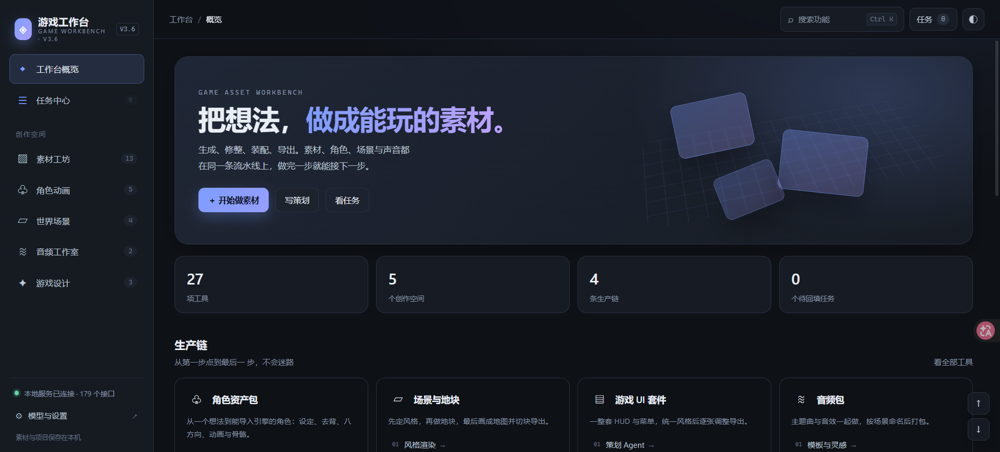
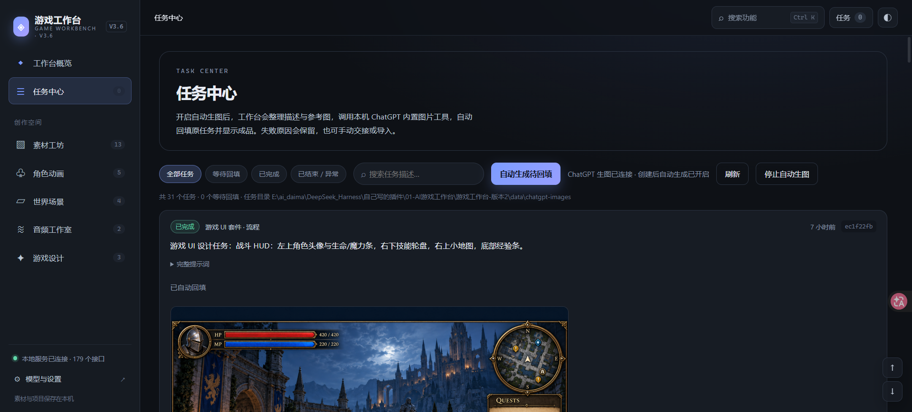
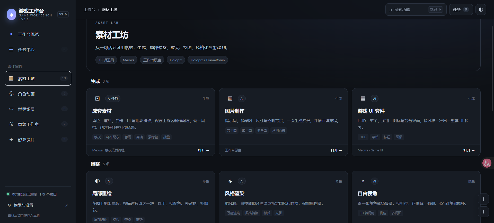
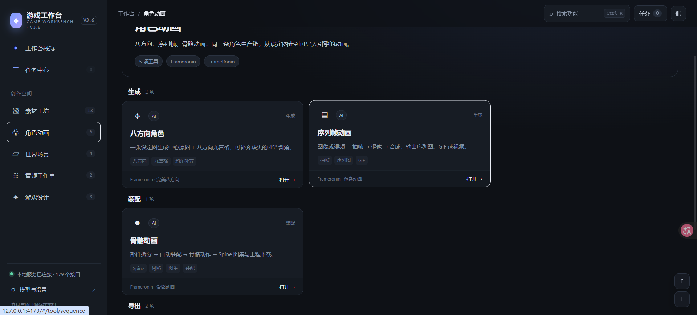
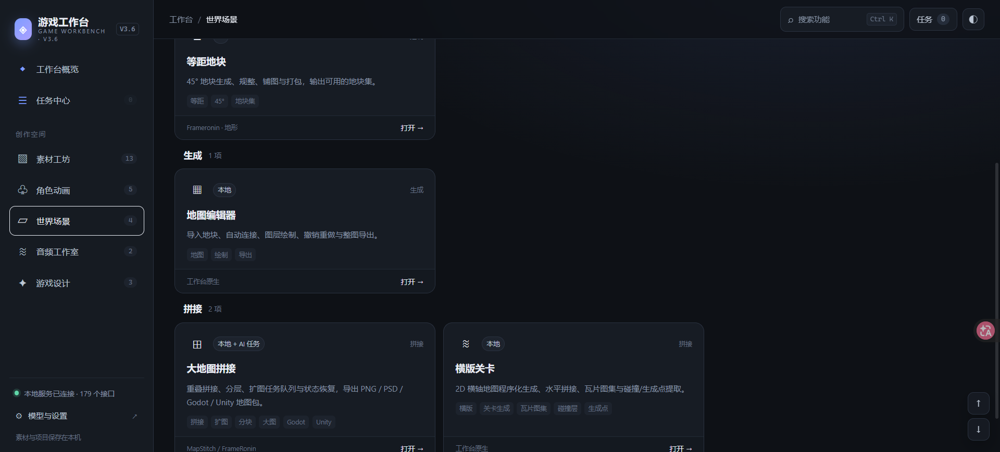
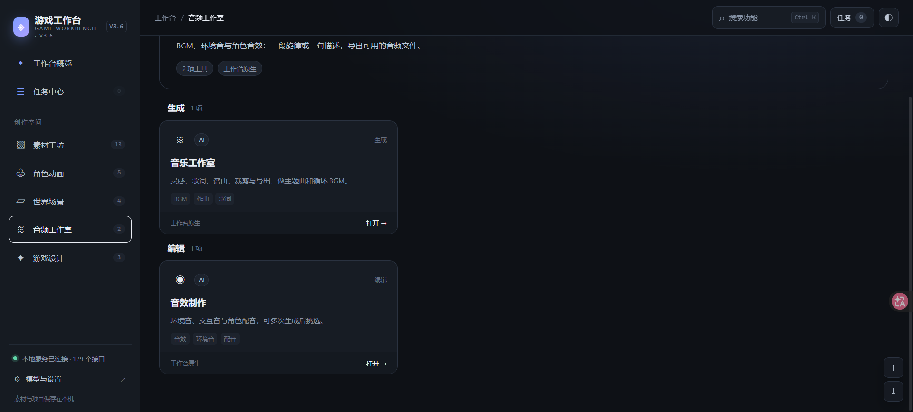
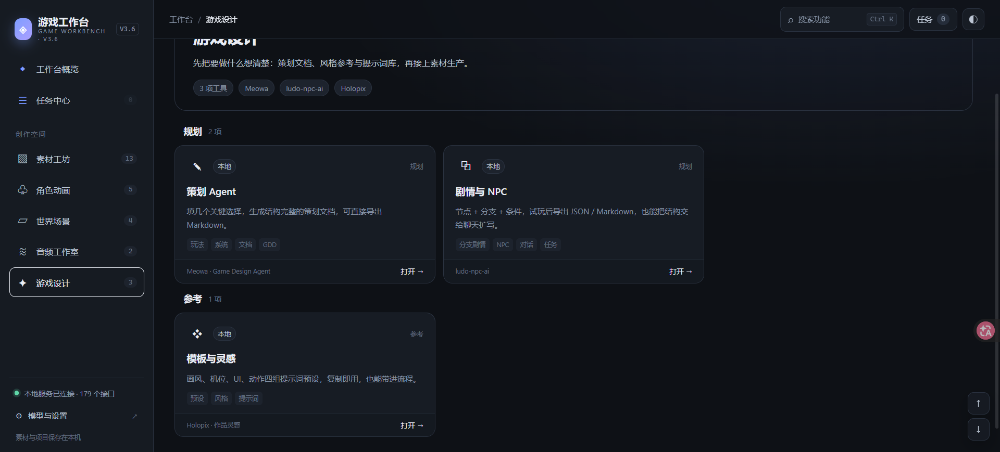

# AI 游戏工作台

基于 TypeScript 的本地游戏素材工作台，将图片、角色动画、地图场景、音频和游戏策划整理到同一套界面中。支持独立浏览器网页与 DeepSeek Harness（DSH）插件两种运行方式。

当前版本：**3.6.0**。项目以本地文件保存工程和任务，适合个人游戏开发、素材整理及 AI 辅助制作。

## 主要功能

工作台按五个创作空间组织，共提供 27 项工具。

| 创作空间 | 工具 |
| --- | --- |
| 素材工坊 | 成套素材、图片制作、游戏 UI 套件、局部重绘、风格渲染、自由视角、智能拆分、图层画布、抠图去背、超清放大、图片调整、视频工具、像素净化 |
| 角色动画 | 八方向角色、序列帧动画、骨骼动画、精灵图集整理、动作与镜头库 |
| 世界场景 | 等距地块、地图编辑器、大地图拼接、横版关卡 |
| 音频工作室 | 音乐工作室、音效制作 |
| 游戏设计 | 策划 Agent、剧情与 NPC、模板与灵感 |

### 图片与素材

- 按提示词和参考图创建图片任务，支持任务记录、结果预览与下载。
- AI 流程中的完整提示词可直接编辑；手动修改后，调整选项不会自动覆盖，可以按参数重新生成提示词。
- 抠图、调色、像素化、颜色量化和最近邻放大等处理在浏览器中完成。
- 图层画布支持图片图层、位置与透明度调整，以及工程、PNG、分层 ZIP 和 PSD 导出。
- 成套素材通过统一主题、风格和规格组织多项任务，制作配方按工作区保存。

### 角色与动画

- 八方向角色、参考图转动画、部件拆分与骨骼装配。
- 本地视频抽帧、抠像与条图合成；本地参考视频可直接作为抽帧来源。
- 精灵图集拆分、多图片帧导入、帧顺序调整、播放预览与动作分组。
- 支持 GIF、PNG 图集、帧数据和部分引擎格式导出。

### 地图与场景

- 地图编辑器提供素材选择、绘制、图层、标记与导出。
- 大地图拼接支持图片导入、重叠设置、选格、扩图任务、状态恢复及分层处理。
- 可导出 PNG、PSD、Godot 和 Unity 地图包。
- 横版关卡支持按种子程序化生成，并导出碰撞和生成点数据。

### 音频与策划

- 音乐、音效流程通过配置的外部服务或对应宿主能力工作。
- 视频工具通过本机 FFmpeg 进行抽帧、裁剪和拼接。
- 策划工具按表单生成本地 Markdown 文档，可继续交给模型扩写。
- 剧情工具支持节点、分支、条件、试玩和数据导入导出。

## ChatGPT 自动生图

项目通过本机 Codex 官方 app-server 调用内置图片工具。需要安装可用的 Codex，并登录支持图片生成的 ChatGPT 账号。

使用步骤：

1. 启动工作台，进入“模型与设置”。
2. 选择 ChatGPT 技能生图后端，开启“创建任务后自动生成并回填”。
3. 在图片制作或 AI 流程中填写提示词，按需上传参考图并提交。
4. 后台执行图片任务，完成后回填对应任务、保存图片并显示结果。

此方式使用当前账号的能力和用量，不是免费无限调用的独立接口。项目技能位于 `.agents/skills/game-workbench-imagegen/SKILL.md`。未开启自动生图时，可通过任务中心交接和手动回填。

其他图片后端包括 OpenAI 兼容接口、ComfyUI 和 Stable Diffusion WebUI；具体可用性取决于服务配置。视频、音乐、音效服务需要分别配置，ChatGPT 图片能力不会替代这些服务。

详细说明见 [ChatGPT 自动生图与回填](docs/ChatGPT生图.md)。

## 环境要求

- Node.js **22.18 或更高版本**，以及 npm。
- 支持 Canvas 的现代浏览器。
- 视频与部分媒体处理需要本机可用的 FFmpeg。
- ChatGPT 自动生图需要本机 Codex 和有效登录状态。
- DSH 插件模式要求 `>=0.2.0-rc.2 <0.3.0-0`，以 `package.json` 为准。

Windows 为当前主要开发和验证环境；其他操作系统仍需单独验证。

## 安装与运行

### 独立网页模式

下载代码后，在项目根目录执行：

```powershell
npm ci
npm run build
npm start
```

启动成功后访问 [本地工作台](http://127.0.0.1:4173/)。Windows 也可使用根目录的 `启动工作台.cmd`。

服务默认运行在本机回环地址，端口为 4173。如果端口被旧版本占用，先保存任务，再使用项目提供的停止旧服务脚本。不要随意结束占用相同端口的未知进程。

### DSH 插件模式

先安装依赖并构建，再执行：

```powershell
dsh plugin --profile web add <本项目目录>
```

将 `<本项目目录>` 替换为实际路径，路径有空格时加引号。安装后重启 DSH，通过侧栏进入工作台；服务前缀为 `/game-workbench/`。

独立网页与插件模式共用核心服务。真实 DSH 环境中的安装与运行效果需要单独验收，模拟宿主测试不能替代实际安装验证。

## 工作区与数据

“模型与设置”用于管理工作区、素材保存位置、生成后端、API Key、默认尺寸和自动生图行为。

| 内容 | 保存位置 |
| --- | --- |
| 独立网页的默认运行数据 | 项目根目录 `data/` |
| DSH 插件数据 | `$DSH_HOME/game-workbench` |
| 素材导出副本 | 当前工作区配置的素材保存位置 |
| 私有模型配置、任务与参考图 | 当前工作区对应的数据目录 |

工作区用于隔离任务、项目和配置。有任务运行时不应切换工作区，切换前应保存页面草稿。备份时需要保留完整数据目录；不要只备份图片而遗漏工程和任务记录。

## 代码结构

```text
.
├─ src/
│  ├─ client/                 # 浏览器工作台界面、路由与原生工具
│  │  ├─ registry.ts          # 创作空间和工具注册表
│  │  ├─ flows.ts             # AI 流程定义与提示词构建
│  │  ├─ lib/                # API、画布、导出等公共能力
│  │  └─ views/              # 工具页面
│  ├─ classic/               # iframe 与经典脚本适配
│  ├─ server/                # 本地服务、任务、设置与生成桥
│  └─ plugin-client/         # DSH 客户端入口
├─ modules/
│  ├─ material/              # 引入并适配的素材模块
│  └─ mapstitch/             # 保留的地图拼接参考模块
├─ public/                   # 浏览器静态资源及编译后的客户端脚本
├─ lib/                      # 编译后的服务端与插件入口
├─ tools/                    # 开发、检查及验收脚本
├─ tests/                    # 自动测试
├─ assets/samples/           # 不含个人信息的程序生成测试图
├─ .agents/skills/           # 项目级生图技能
├─ docs/                     # 来源及发布说明
└─ package.json              # 依赖、运行命令与包入口
```

应用源码以 TypeScript 为主；`modules/` 中保留第三方引入代码及其原有文件组织。`lib/` 和 `public/` 的编译产物用于直接运行和 DSH 分发，不能作为普通缓存全部删除。

### 主要模块职责

| 文件或目录 | 职责 |
| --- | --- |
| `src/client/app.ts` | 页面路由、导航与工具挂载 |
| `src/client/registry.ts` | 工具分类、入口和描述 |
| `src/client/flows.ts` | 共用 AI 流程参数与提示词模板 |
| `src/server/host.ts` | 两种运行形态共用的服务与 API 路由 |
| `src/server/settings.ts` | 工作区和设置保存 |
| `src/server/bridge.ts` | 图片任务记录、等待与结果回填 |
| `src/server/native-image.ts` | Codex 内置图片工具调用 |
| `src/server/codex-rpc.ts` | Codex app-server 通信 |
| `src/server/material-engine.ts` | 原素材模块的工作区适配 |

## 开发与扩展

常用命令：

```powershell
npm run build       # 编译应用
npm run typecheck   # 检查应用类型
npm test            # 运行自动测试
npm run check:ts    # 检查 TypeScript 源码组织
npm run check:plugin
```

更多验收脚本见 `package.json`。运行真实生图检查会使用账号用量；不要将它当作普通离线测试反复执行。

新增工具时，先在 `registry.ts` 中定义分类和入口，再实现对应页面。参数驱动的生图工具可复用 `flows.ts` 和通用流程页面。涉及文件、工作区或任务时，应调用共用服务，避免在多个页面重复实现保存和回填逻辑。

修改 TypeScript 源码后重新构建，不要只修改 `lib/` 或 `public/` 中的对应脚本。修改 `modules/material/` 前应先阅读该目录的 `AGENTS.md`；该模块有独立构建流程，根目录构建不替代它的编译。

## 验证范围与限制

项目包含本地图片处理、视频处理、任务桥、工作区和插件接口的测试，也做过部分浏览器实操。页面能打开、自动测试通过和真实模型生成成功属于不同层次的证据。

- 骨骼自动装配、AI 拆件、八方向一致性和地块造型仍需要人工检查。
- 音视频外部服务需要有效凭据和服务额度，不能仅凭页面加载认定可用。
- 导出引擎包不代表已完成 Godot、Unity、RPG Maker 或 Spine 中的运行验证。
- 现有工具仍需继续补充逐项完整流程测试，不宣称全部 27 项功能已完成端到端验收。

## GitHub 发布与隐私

仓库不应包含个人素材、运行任务、API Key、参考图、测试截图或历史压缩包。

项目通过 `.gitignore` 排除 `data/`、`node_modules/`、`test-results/`、`artifacts/`、个人测试素材、环境变量文件和常见凭据文件。npm 发布另使用 `.npmignore`。

请用 Git 提交本项目，不要直接拖拽整个目录上传到 GitHub 网页；这种上传方式不会自动遵守忽略规则。已经被 Git 跟踪或进入历史记录的敏感文件，也不会因增加 `.gitignore` 而自动消失。

发布前阅读 [隐私检查说明](docs/发布前隐私检查.md)，并检查暂存区内容：

```powershell
git status --short --ignored
git diff --cached --stat
git diff --cached
```

## 参考来源与许可

项目整合了 MapStitch 与 dsh-game-material-master 的相关代码，并参考 Holopix、Meowa、FrameRonin 的公开功能组织方式。功能参考不代表获得了这些商业网站的源码、服务或品牌授权。

- [MapStitch 模块说明](modules/mapstitch/README.md)
- [素材模块说明](modules/material/README.md)
- [素材模块许可证](modules/material/LICENSE)
- [来源记录](docs/复刻来源清单.json)

保留各第三方模块的许可证和署名，具体使用、修改及分发条件以对应许可证为准。本说明不为整个项目新增或承诺统一的开源许可；公开发布前应确认自有代码采用的许可证，并分别核实第三方代码和素材的权利。

## 相关文档

- [开发说明](docs/开发说明.md)：架构、工作区、构建和扩展约束。
- [ChatGPT 生图](docs/ChatGPT生图.md)：账号要求、自动任务、回填及验证边界。
- [地图拼接](docs/地图拼接.md)：导入、扩图、图层、状态恢复和导出。
- [发布前隐私检查](docs/发布前隐私检查.md)：GitHub 与 npm 发布注意事项。
- [素材模块工程文档](modules/material/docs/ENGINEERING.md)：原模块维护细节。

## 项目截图：















